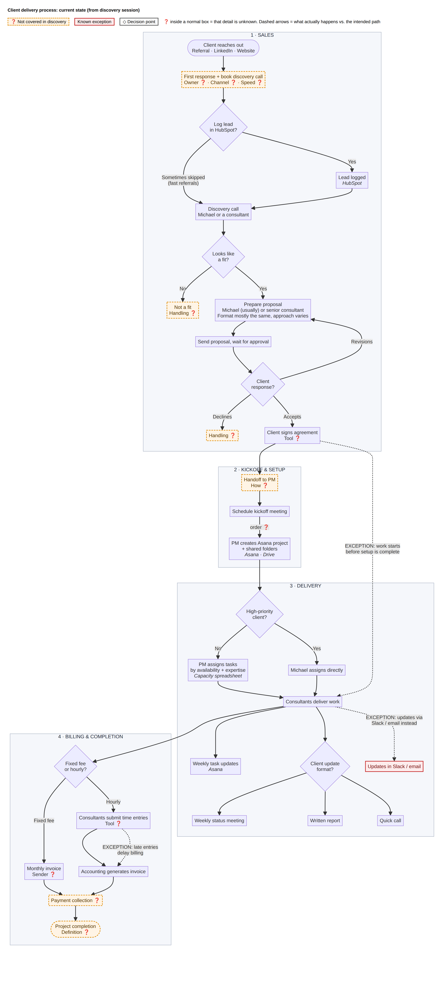

# Process Discovery Case Study: Consulting Firm Client Delivery

From one incomplete discovery call to a documented current-state process, a list of the gaps and the questions to close them, and a prioritized plan for process fixes, automation and AI.

> **Fictional practice case.** The firm and the stakeholder are made up, and this isn't client work. [Read the scenario and full transcript →](case/scenario.md)

## Executive summary

- **What I found:** the firm has the right tools (HubSpot, Asana, Google Drive, Slack) and an intended process from lead to billing. At almost every stage, though, what actually happens differs from that intended process. Leads skip HubSpot, work starts before setup, status lives in Slack and email, and time entries come in late.
- **Biggest gaps:** no owner was described for the first response to a lead or for the handoff from sales to delivery. "Completion" is never defined, and four key tools were never named.
- **Root cause:** the problem is missing rules, owners and connections between tools, not missing software.
- **Recommendation:** first define the process and an owner for each stage. Then automate the handoffs: lead capture, project setup when a deal is signed, time-entry reminders, and AI drafts of proposals and client updates that a person reviews.

## What's inside

| | File | What it covers |
|---|---|---|
| 📄 | [The case](case/scenario.md) | Scenario, discovery transcript and brief |
| 1 | [Discovery analysis](deliverables/01-discovery-analysis.md) | 13-stage process summary, inputs and outputs, 9 decision points, 20 information gaps, ownership map, 31 follow-up questions |
| 2 | [Process documentation](deliverables/02-process-documentation.md) | Workflow diagram, step-by-step process with owners and systems, decision table, 8 known exceptions (intended vs. actual) |
| 3 | [Improvement and AI](deliverables/03-improvement-and-ai.md) | 10 operational challenges, 8 prioritized recommendations, 7 automation and AI opportunities with a rollout order |
| 🗺️ | [diagram/](diagram/) | Workflow as a PNG and as [Mermaid source](diagram/workflow.mmd) |

## Approach

1. **Keep facts apart from guesses.** Every statement is either what the stakeholder said, an **[Assumption]**, or **[Unknown]**. Nothing is filled in silently.
2. **Look for the steps nobody described.** Between "a client reaches out" and "we have a discovery call", someone has to reply. Between "the client signs" and "the PM sets up the project", someone has to tell the PM. Neither step was described, and both are where leads and context get lost.
3. **Map the intended process against what actually happens.** Each stage has an official version and a real one. The gap between them is the main finding, and it runs through all three parts.
4. **Ask questions that build on what was said.** The follow-up questions don't repeat what the stakeholder already covered. Each one points back to a numbered gap, and the list ends with real documents to request, because documents show what happens better than interviews do.
5. **Fix the process before automating it.** Rules and owners come first. Automation and AI come second, using the tools the firm already pays for, and an AI draft never goes to a client without a person reviewing it.

## Author

**Daksh Vanshaj** · [GitHub](https://github.com/dakshvanshaj)
