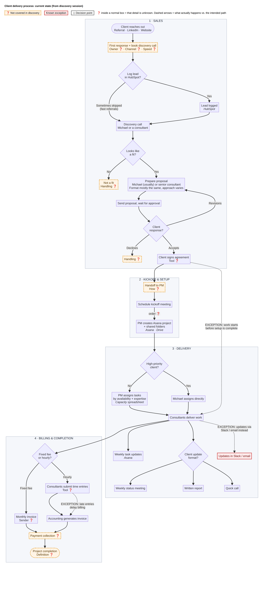
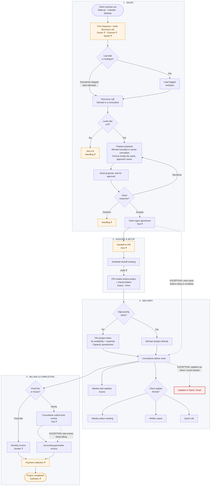

# Part 2: Process Documentation

← [Back to overview](../README.md) · Case: [scenario and transcript](../case/scenario.md)

**Labels used:** statements from the transcript are facts. Anything inferred is marked **[Assumption]**. Anything not covered in the session is marked **[Unknown]**. Gap numbers (e.g. "Gap 9") refer to section 1B in [01-discovery-analysis.md](01-discovery-analysis.md).

## 2A. Workflow Diagram

*Full-resolution image: [diagram/workflow.png](../diagram/workflow.png). Source: [diagram/workflow.mmd](../diagram/workflow.mmd).*

How to read it: orange dashed boxes were not covered in discovery. Red boxes and dotted arrows are known exceptions, where what actually happens differs from the intended path. Diamonds are decision points. A ❓ inside a normal box means only that detail is unknown. The Mermaid source below renders on GitHub, Notion and most Markdown viewers.

Note: the transcript gives the kickoff before Asana setup, but doesn't confirm that order (1B, Gap 9).

## 2B. Structured Process Document

### Process overview

| | |
|---|---|
| **Process name** | Client delivery: lead intake to billing |
| **Process owner** | Not named. Michael Reynolds, Managing Partner **[Assumption]** |
| **Trigger** | A potential client reaches out through a referral, LinkedIn or the website |
| **End point** | The invoice is sent. "Project completion" is not yet defined **[Unknown]** |
| **Engagement types** | Fixed-fee (invoiced monthly) and hourly (invoiced from time entries) |
| **Systems** | HubSpot, Asana, shared folders / Google Drive, a capacity spreadsheet, Slack, email. Not named: proposal, e-signature, time-tracking and invoicing tools |
| **Current state** | The intended process is clear, but every stage has informal variations, and documents are stored in Asana, Drive and email |

### Workflow steps

| # | Step | Responsible | System | Notes |
|---|---|---|---|---|
| 1 | Client reaches out | Client | Referral, LinkedIn, website | "Most clients", so other sources may exist |
| 2 | Reply to the inquiry and book a discovery call | **[Unknown]** | **[Unknown]** | Not described |
| 3 | Log the lead | Whoever handles the lead **[Assumption]** | HubSpot | Sometimes skipped for fast referrals |
| 4 | Run the discovery call | Michael or a consultant | **[Unknown]** (call tool, notes location) | Learn the client's needs |
| 5 | Decide fit | Whoever ran the call **[Assumption]** | None | Criteria not defined |
| 6 | Prepare the proposal | Michael (usually) or a senior consultant | **[Unknown]** | "Format is mostly the same, although everyone has their own approach" |
| 7 | Send the proposal and wait for approval | The proposal author **[Assumption]** | Email **[Assumption]** | Revisions loop back to step 6 |
| 8 | Sign the agreement | Client, and the firm signer **[Unknown]** | **[Unknown]** | |
| 9 | Hand off to delivery | **[Unknown]** | **[Unknown]** | Not described. **[Assumption]** that this step exists |
| 10 | Schedule the kickoff meeting | **[Unknown]** | **[Unknown]** | Includes the client **[Assumption]** |
| 11 | Create the project and shared folders | Project manager | Asana, shared folders | Sometimes not done before work starts |
| 12 | Assign tasks | PM (usually). Michael for high-priority clients | Asana, capacity spreadsheet | Based on availability and expertise |
| 13 | Deliver the work and update progress weekly | Consultants | Asana | Some update through Slack or email |
| 14 | Update the client | **[Unknown]** (PM or consultant **[Assumption]**) | Meetings, written reports or calls | Format varies by engagement |
| 15a | Fixed fee: send the monthly invoice | **[Unknown]** (accounting **[Assumption]**) | **[Unknown]** | "Usually" monthly |
| 15b | Hourly: submit time entries | Consultants | **[Unknown]** | Sometimes late |
| 15c | Hourly: generate the invoice | Accounting | **[Unknown]** | Delayed when time entries are late |
| 16 | Collect payment and close the project | **[Unknown]** | **[Unknown]** | Not described |

### Decision points

| # | Decision | Who decides | Rule today | Outcomes |
|---|---|---|---|---|
| D1 | Log the lead in HubSpot? | Whoever handles the lead | None. Skipped when "moving quickly" on referrals | Logged / not logged |
| D2 | Who runs the discovery call? | **[Unknown]** | **[Unknown]** | Michael / a consultant |
| D3 | Is the client a fit? | **[Unknown]** | "If it looks like a fit" | Proposal / not a fit (handling **[Unknown]**) |
| D4 | Who writes the proposal? | **[Unknown]** | Usually Michael | Michael / a senior consultant |
| D5 | Client response to the proposal | Client | n/a | Accept → agreement. Revise → step 6. Decline → **[Unknown]** |
| D6 | Start before setup is complete? | **[Unknown]** | When the client wants to move quickly | Wait / start early |
| D7 | Who assigns the work? | Michael or the PM | High-priority clients go to Michael ("high priority" not defined) | PM / Michael |
| D8 | Client update format | **[Unknown]** | Varies by engagement | Meeting / written report / call |
| D9 | Billing path | Set by the agreement **[Assumption]** | Engagement type | Fixed fee → monthly invoice. Hourly → time entries |

### Known exceptions (stated in the transcript)

| # | Intended | What actually happens | Effect |
|---|---|---|---|
| E1 | Every lead is logged in HubSpot | Fast-moving referrals are sometimes not logged | Incomplete pipeline. Lead history may be lost |
| E2 | Proposals follow a mostly shared format | Each author has their own approach | Inconsistent client experience. Hard to reuse proposals |
| E3 | Setup is finished before work starts | Consultants sometimes start early because clients want to move quickly | Work isn't tracked in Asana from day one. Files start in scattered places |
| E4 | The PM assigns work | Michael assigns directly for high-priority clients | The PM and the capacity spreadsheet may not reflect who is busy **[Assumption]** |
| E5 | Weekly progress updates in Asana | Some consultants update through Slack or email | No single view of project status |
| E6 | Weekly status meetings (the typical format) | Meetings, written reports or calls, depending on the client | Different amounts of effort per client. No standard for updates |
| E7 | Time entries arrive on time | Time entries sometimes come in late | Hourly invoicing is delayed, which affects cash flow **[Assumption]** |
| E8 | Documents in one place | Spread across Asana, Google Drive and email | Time lost searching. Risk when people leave |

### Areas that need clarification
These are covered in full in 1B and 1C. In priority order:
1. **First response and handoff** (steps 2 and 9): no owner, so leads and client context can be lost.
2. **Completion and payment collection** (step 16): the end of the process is undefined.
3. **Early starts** (E3): how often it happens, and whether it ever happens before the agreement is signed.
4. **Unnamed tools** (proposal, e-signature, time tracking, invoicing): needed before any automation can be designed.
5. **Decision rules** (D2, D3, D4, D6, D7, D8): each depends on someone's judgement, with no written rule.
6. **Who owns client updates and fixed-fee invoices** (steps 14, 15a).
